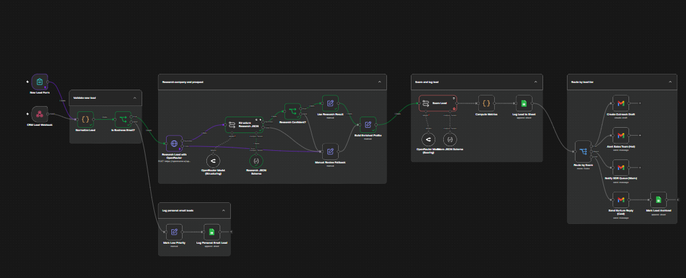
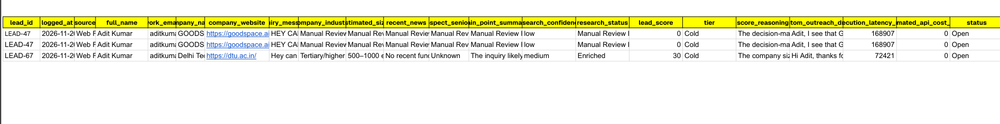
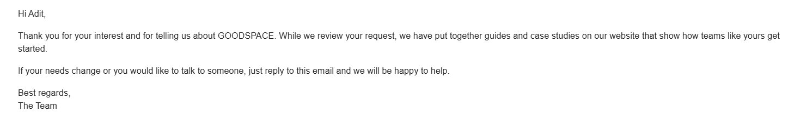

  # Autonomous B2B Lead Enrichment, Scoring & Routing Pipeline

An end-to-end, zero-cost RevOps automation built in **n8n** that ingests inbound leads (via Web Form or CRM Webhook), performs live web research using **OpenRouter (`openrouter/free` with web search)**, scores prospects deterministically against an Ideal Customer Profile (ICP) rubric, logs telemetry to **Google Sheets**, and routes leads with Human-in-the-Loop **Gmail** guardrails.

> **Demo Video:** [Watch 60-Second Walkthrough](https://www.loom.com/share/875c40d422db4e0e9394d483e4bf4377)

---

## System Architecture

<!-- 📸 IMAGE 1: Take a full-canvas screenshot of your n8n workflow showing all 5 node groups clearly connected. Save as assets/workflow-architecture.png -->

### Pipeline Stages
1. **Dual-Channel Intake & Normalization (`Validate new lead`):**
   * Accepts leads from both an embedded **n8n Web Form** (`/b2b-lead-intake`) and a **CRM POST Webhook** (`/b2b-lead-intake-crm`).
   * A JavaScript **Code Node** normalizes inconsistent field names (`full_name`, `Full Name`, `fullName`) into a unified schema with a unique `lead_id` and ISO timestamp.
   * **Pre-LLM Cost Gate:** An `IF` node filters out free personal email domains (`@gmail.com`, `@yahoo.com`, `@hotmail.com`), logging them directly as `Low Priority` without burning LLM tokens.

2. **Live Web Research & Strict JSON Parsing (`Research company and prospect`):**
   * Queries OpenRouter's free router (`openrouter/free`) with the `web` plugin enabled (`max_results: 3`) to gather company industry, employee headcount, recent 12-month news/funding, prospect LinkedIn seniority, and core pain points.
   * Passes raw research notes through a **Structured Output Parser** enforcing a strict 6-field JSON schema (`company_industry`, `estimated_size`, `recent_news`, `prospect_seniority`, `pain_point_summary`, `research_confidence`).
   * **Reliability & Error Fallbacks:** Configured with `retryOnFail` and `continueErrorOutput`. If an API timeout occurs or `research_confidence` returns `low`, a **Manual Review Fallback** node populates safe defaults instead of dropping the lead.

3. **Deterministic ICP Scoring & Telemetry (`Score and log lead`):**
   * Evaluates enriched profiles at `temperature: 0.1` against a strict 100-point rubric:
     * **+40 pts:** Decision-maker title (Founder, C-Level, VP, Head of, Director, Owner)
     * **+30 pts:** Company size > 50 employees
     * **+30 pts:** Clear B2B use case stated in inquiry
   * A **Compute Metrics** Code Node programmatically re-derives the tier from the numerical score (preventing LLM classification drift), calculates end-to-end execution latency (`execution_latency_ms`), and logs `$0.00` unit cost to **Google Sheets**.

4. **Tier-Based Routing & Human-in-the-Loop Guardrails (`Route by lead tier`):**
   * **Hot Leads (`Score >= 70`):** Creates a personalized **Gmail Draft** (Human-in-the-Loop guardrail so reps review before sending) and dispatches an HTML alert email to the sales team.
   * **Warm Leads (`Score 40–69`):** Sends an enriched dossier and suggested outreach copy to the SDR queue.
   * **Cold Leads (`Score < 40`):** Sends an automated resource/nurture reply and logs the lead to the `Archive` tab.

---

## Live Execution Proof

### 1. Intake Form & Enriched Google Sheets Tracker

<!-- 📸 IMAGE 2: Take a screenshot of your Google Sheet showing enriched rows with lead_score, tier, score_reasoning, execution_latency_ms, and estimated_api_cost_usd. Save as assets/google-sheets-tracker.png -->

### 2. Automated Sales Alert & Human-in-the-Loop Gmail Draft

<!-- 📸 IMAGE 3: Take a screenshot showing the formatted HTML "HOT LEAD" alert email and/or the auto-generated Gmail Draft in your inbox. Save as assets/gmail-alert-and-draft.png -->

---

## Key Engineering Highlights

| Feature | Implementation Detail | Business / Reliability Impact |
| :--- | :--- | :--- |
| **Zero-Cost Inference** | Uses `openrouter/free` with web search plugin + `temperature: 0–0.1` | Eliminates Perplexity/OpenAI API costs (`$0.00/lead`) |
| **Hallucination Guardrails** | Two-stage Research → Structured JSON Parser + programmatic tier re-derivation | Guarantees downstream nodes never break on malformed LLM text |
| **Fault Tolerance** | `retryOnFail` + `continueErrorOutput` routed to `Manual Review Fallback` | Zero silent lead drops during API rate limits or timeouts |
| **Human-in-the-Loop** | Hot leads generate **Gmail Drafts** rather than auto-sending outbound emails | Prevents unreviewed AI emails from reaching high-value enterprise prospects |
| **Observability** | Custom JS telemetry tracking `execution_latency_ms` per lead | Enables real-time SLA and pipeline performance monitoring |

---

## Setup & Installation

1. **Prerequisites:**
   * Self-hosted or cloud **n8n** instance (`v1.70+`).
   * Free API key from [OpenRouter](https://openrouter.ai/) (set key credit limit to `$0` to guarantee free-tier-only routing).
   * Google Cloud OAuth2 credentials enabled for **Google Sheets** and **Gmail**.

2. **Import Workflow:**
   * Download `B2B Lead Enrichment, Scoring & Routing.json` from this repository.
   * In n8n, click **Add Workflow** → **Three Dots (`⋮`)** → **Import from File** and select the JSON file.

3. **Configure Credentials & Targets:**
   * Attach your **OpenRouter**, **Google Sheets**, and **Gmail** credentials to the highlighted nodes.
   * Create a Google Sheet with tabs named `Leads` and `Archive`, and select it in the three Google Sheets nodes.
   * Update the recipient email addresses in **Alert Sales Team (Hot)** and **Notify SDR Queue (Warm)**.
   * Toggle the workflow **Active** and test via the **New Lead Form** production URL.